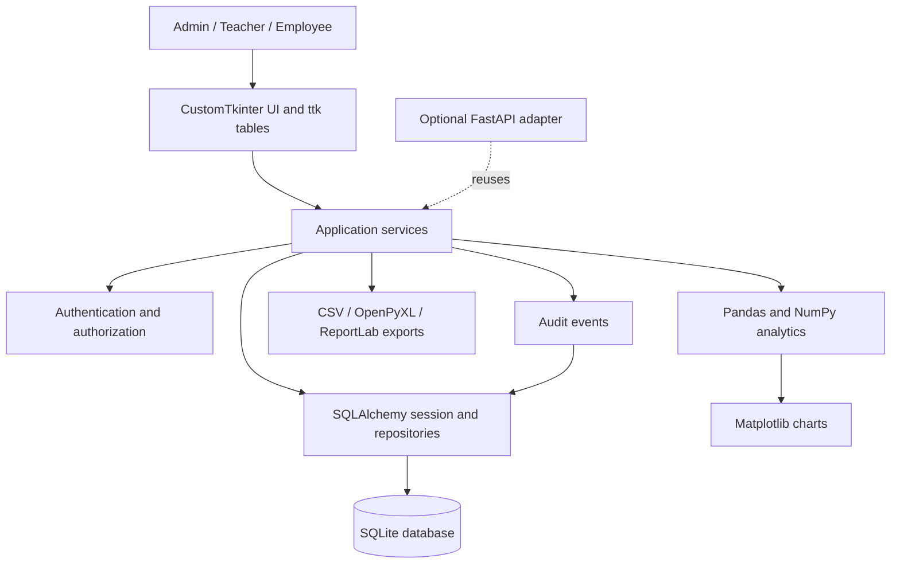

# Architecture

## Design principles

- Keep the Python desktop application local-first and usable without the optional API.
- Keep UI event handlers thin. Validation, authorization, calculations, and transactions belong in services or domain-level helpers.
- Treat SQLAlchemy models and explicit schema-upgrade procedures as the database contract. Avoid maintaining a second, divergent schema definition in handwritten SQL.
- Keep analytics as pure transformations of queried data where possible, so they can be tested without a GUI.
- Do not place credentials, personal datasets, generated databases, or build artifacts in source control.

## Component boundaries

## Responsibilities

| Area | Responsibility |
| --- | --- |
| `main.py`, `config.py` | Load validated configuration, initialize logging and database access safely, start the desktop application. |
| `database/` | SQLAlchemy models, session/engine creation, constraints, and documented schema upgrades. No UI code. |
| `services/` | Use-case operations, input validation, role checks, transactions, and audit events. |
| `ui/` | Login, navigation, forms, tables, confirmations, and display of service outcomes. UI does not issue ad hoc SQL. |
| `analytics/` | Build DataFrames from service/query results and calculate explicit, reproducible metrics. |
| `reports/` | Render validated report data to CSV, Excel, and PDF. Report generation does not bypass service authorization. |
| `api/` | Optional HTTP adapter with request/response validation and authentication; delegates to the same services. |
| `tests/` | Test services and analytics with temporary SQLite databases; UI/API tests only where those adapters exist. |

## Data flow

1. A user authenticates and receives a role-bound application session.
2. A UI action calls a service with validated input and the current actor.
3. The service checks permissions and applies domain rules within a database transaction.
4. Successful sensitive changes emit an audit event in the same transaction where feasible.
5. Read services return authorized records to the UI, analytics, or report layer.
6. Analytics explicitly identify missing data, filters, and denominators before charting or export.

## Security and privacy boundaries

- Use a maintained password-hashing library with an adaptive algorithm; never compare or store plaintext passwords.
- Enforce role checks in services for every protected operation. UI visibility is not authorization.
- Use bound SQLAlchemy expressions; do not construct SQL from user input.
- Keep database files, backups, profile images, logs, and secrets outside tracked source paths by default.
- Minimize audit payloads: record actor, action, entity, timestamp, and necessary change metadata, not passwords or full sensitive records.
- Backups contain personal information and require restricted filesystem permissions and an explicit retention policy.

## Database lifecycle

The application creates missing tables without dropping existing tables or replacing the database. Startup performs an additive, idempotent SQLite update for newly introduced nullable student/employee profile columns and creates the admission-number index; it never rebuilds profile tables. Other schema changes require a documented migration/schema-update step. Initial admin creation is an explicit `python main.py --setup-admin` command and is refused once any user exists. Backup restoration must validate a candidate copy before it replaces the active database and must retain a recoverable pre-restore backup.

## Planned package layout

The top-level module layout is documented in the README. Implementation should add packages incrementally as each phase is built; empty placeholder modules are not considered implemented features.