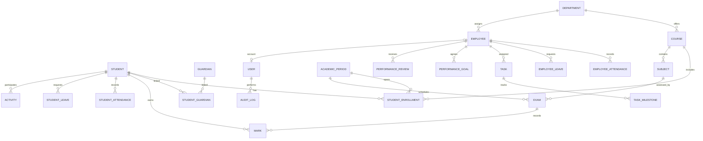

# Database Design

## Storage conventions

- SQLite with SQLAlchemy declarative models, foreign keys enabled, and transaction-scoped writes.
- Internal primary keys are integer IDs unless a later deployment requirement justifies UUIDs. Human-facing register numbers and employee codes are separate unique fields.
- Store timestamps consistently in UTC; store date-only academic and attendance dates as dates. Convert to local time for display.
- Use explicit status values and check constraints. Do not encode important state only in UI labels.
- Archive operational records where history matters instead of cascading deletion. Define retention/deletion policy before implementing personal-data erasure.

## Entity relationship overview

## Tables and constraints

| Table | Key fields and rules |
| --- | --- |
| `users` | `id`, unique `username`, `password_hash`, role (`admin`, `teacher`, `employee`), active flag, optional unique `employee_id`; no plaintext password field. |
| `departments` | Unique code and name, active/archive state. Referenced by courses and employees. |
| `courses` | Unique code, name, required department FK, active/archive state. |
| `students` | Unique register number; admission number unique when present; name, contact, optional DOB/address, admission date, active/archive state. Do not duplicate mutable course placement here. |
| `guardians` | Guardian name and contact. `student_guardians` links students and guardians with relationship and primary-contact flag; unique student/guardian pair. |
| `student_enrollments` | Student, course, academic period/year, semester, section, enrollment dates/status. Indexed by student and period; supports historical enrollment. |
| `employees` | Unique employee code, name, work contact, department, designation, join date, status, optional manager self-FK, emergency contact. Skills/certifications may use related tables if searchable. |
| `academic_periods` | Unique period label and start/end dates with `start_date <= end_date`. |
| `subjects` | Unique code, name, course FK, active state. |
| `exams` | Subject and academic-period FKs, name, maximum and pass marks with `0 <= pass_marks <= maximum_marks`, exam date. |
| `marks` | Unique exam/student pair. Status `pending`, `absent`, or `entered`; entered requires a non-null value within `[0, maximum_marks]`; pending/absent require null value. An entered value of `0` is valid. |
| `student_attendance` | Student FK, date, session, status, optional times; unique student/date/session; status constrained to configured values. |
| `employee_attendance` | Employee FK, date, shift/session, status, optional check-in/out; unique employee/date/session. Check-out cannot precede check-in. |
| `student_leaves`, `employee_leaves` | Separate owner FKs, date range, reason, request/approval status, reviewer and timestamps. Date range check; approval state is not attendance state. |
| `activities` | Student FK, title, category, participation date, description, optional certificate reference. |
| `tasks` | Employee FK, title, description, assigned/deadline dates, status, optional project name/reference and completion notes. |
| `task_milestones` | Task FK, title, due/completed dates, status; deleting a task may cascade only to its owned milestones. |
| `performance_goals` | Employee FK, period, agreed criterion, target, measurement method, progress/value, status. Criteria and progress basis must be explicit. |
| `performance_reviews` | Employee FK, reviewer employee FK, period dates, manager feedback, optional rubric-based scores. No automatic score derived solely from attendance/task count. |
| `audit_logs` | Actor user FK where available, action, entity type/ID, timestamp, minimal change metadata. Never store credentials or unnecessary full-record snapshots. |

## Integrity, deletion, and indexing

- Add foreign keys for every relationship and enable SQLite foreign-key enforcement on each connection.
- Use `UNIQUE`, `CHECK`, and `NOT NULL` constraints in addition to service validation. Add indexes for register/employee codes, common filter fields, foreign keys, and date-range queries.
- Avoid cascading deletion from students, employees, exams, or users into academic, attendance, review, or audit history. Archive/disable records and define a controlled retention process instead.
- Use a transaction for multi-record workflows such as mark imports, leave approvals, and audit-backed edits. Roll back the whole operation on validation or persistence failure.
- Use separate student and employee attendance/leave tables to retain real foreign-key integrity rather than a polymorphic owner ID with no enforceable FK.

## Calculation semantics

- A pending mark has no entered value; an absent mark is a distinct status; a recorded zero is an entered numeric value. Reports display each state distinctly.
- A percentage is undefined when its eligible denominator is zero; return a documented empty/undefined result, not zero or NaN silently.
- Pass percentage uses eligible entered marks as its denominator unless the approved institution policy explicitly chooses otherwise. Report absent and pending counts separately.
- Attendance percentage uses eligible scheduled sessions as denominator and present sessions as numerator. The schedule/leave treatment must be configured and documented before release.
- Every aggregate identifies its filters, population, missing-value handling, and denominator in the service/report contract.

## Schema evolution and backups

Use a documented migration process when the application changes schema. Never drop/recreate an existing database during ordinary startup. Backups must be timestamped, access-restricted, validated before restore, and tested using an isolated database. Restore should validate integrity and preserve a pre-restore copy before switching the active database.